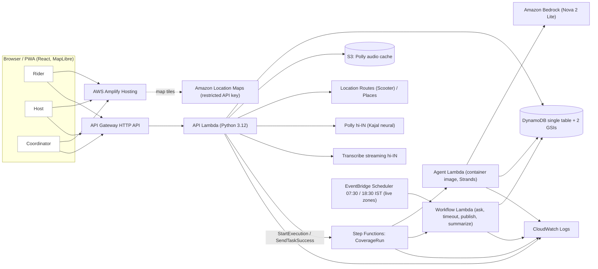

# Pyau — water, shade and rest for delivery riders in the heat

**Track 02 · Heat and Water · WeMakeDevs × AWS Environmental Hacks (8–11 Oct 2026)**

> A *pyau* (प्याऊ) is the old street-side water stall: a clay pot, a ladle, free water for anyone passing. Riders now depend on scattered goodwill they cannot see on any map. Pyau makes that goodwill findable, keeps it confirmed, and uses an AI agent to fill the gaps before the afternoon heat.

**Live demo (no sign-up):** <https://main.d1lgs9hxx2cuwt.amplifyapp.com/demo> · host sign-up: [`/host`](https://main.d1lgs9hxx2cuwt.amplifyapp.com/host) · rider: [`/ride`](https://main.d1lgs9hxx2cuwt.amplifyapp.com/ride) · saved run: [`/replay/latest`](https://main.d1lgs9hxx2cuwt.amplifyapp.com/replay/latest)

The demo runs on a **documented synthetic scenario on a real map** (East Delhi, 21 May 2026). All hosts, rider requests and temperatures are invented; the figures below are scenario arithmetic, **not measured outcomes**.

## What it does

| Who | What they get |
|---|---|
| **Rider** (anonymous) | Taps or asks in Hindi — *"bhaiya paani kahan milega?"* — and gets the nearest open, **confirmed-today** water/shade/toilet/charging point, a scooter route, and a **spoken Hindi answer**. Afterwards: *Got it ✓* / *Problem ✗*. |
| **Host** (shop, chemist, temple, RWA, home, dhaba) | Registers a point in under a minute (pin → address from Amazon Location Places, listed or standby, consent). Gets a morning "still serving water today?" check and, on hot days, a polite request from the coordinator. |
| **Coordinator** | Sees tomorrow's heat curve and the real coverage number, runs the **coverage agent**, reviews the plan (messages in Hindi + English, ordered hosts, unfilled gaps), approves in one click, and watches the outreach happen. Two rider problem reports pause a point automatically; the coordinator reactivates it. |

### The loop (East Delhi sample scenario)

44 rider water requests fall in the 13:00–16:00 heat window; **22 of 44 (50.0%)** have an open, confirmed water point within 500 m. The agent finds cluster B (18 requests) and D (4) uncovered, proposes asking the Kirana store, then the RWA office for B, and flags D for a human (no host within 500 m). After approval, Step Functions asks the Kirana store → **no reply in 45 s (demo timer) → times out** → asks the RWA office → **accepts 12:00–17:00** → the point goes live → coverage becomes **40 of 44 (90.9%)**. D stays red. A rider in cluster B at 14:00 then gets the RWA office, 176 m away in a straight line (261 m by scooter route), with a Hindi voice answer.

Every number comes from code (`packages/domain`). The model plans, prioritises and writes the messages; it never computes distances, coverage, ranking or timing, and it cannot send, approve, add hosts or reorder candidates.

## Architecture (what is actually deployed)



`CoverageRun` (Step Functions Standard): **PlanWithAgent → AwaitApproval** (task token, timeout) **→ Map over gaps → PickNextHost → AskHost** (task token, per-ask timeout) **→ PublishPoint | MarkTimedOut → next host | MarkUnresolved → Summarize**. A host's answer or a coordinator's approval calls `SendTaskSuccess`; waiting costs no compute. Task tokens never leave the server and are not written to logs (state-machine logging has execution data off).

### AWS services actually used

Amplify Hosting · Amazon Location Service (Maps, Places, Routes/Scooter) · API Gateway (HTTP API) · Lambda (zip + container image) · Step Functions · Amazon Bedrock (via Strands Agents) · DynamoDB · S3 · Polly · Transcribe (streaming) · CloudWatch · ECR · Secrets Manager (demo-token signing key) · EventBridge Scheduler and Cognito are **provisioned but not exercised by the demo** (see limitations).

## Verified behaviour

Everything below was run against the deployed stack with real AWS services (no mocks); logs of each check are in [`tasks.md`](tasks.md) and evidence in [`docs/evidence/`](docs/evidence/).

| Check | Command | Result |
|---|---|---|
| Fixture arithmetic | `python scripts/verify_fixture.py` | passes (13:00–16:00, 44, 22/44, B→[H4,H5], D→none, 40/44, rider→H5) |
| Domain + validation tests | `python -m pytest` | 37 passed (coverage, candidates, heat window, proposal validation incl. invented host / reordering / money promise / missing window, trust rule, intents) |
| Full loop on the deployed API | `python scripts/smoke_loop.py` | real Bedrock agent run → approval → 45 s timeout → late answer `409` → accept → 90.9% → rider answer; Step Functions history has both branches |
| Authority + failure injection | `python scripts/gate_authority.py` | 13/13 (cross-session tokens refused, demo clock refuses live, Routes/Polly failure fall back honestly, Bedrock denied → run `FAILED`, prompt-injection host label stays data) |
| Trust loop | `python scripts/smoke_trust.py` | two reports pause a point, coverage recomputes by code, `STALE_INPUT` if a host is paused after the proposal |
| Release gate | `python scripts/gate_loops.py 3` | **3/3 consecutive full `/demo` loops in a real browser**, each run id found in Step Functions and CloudWatch |
| Phone layout | `node scripts/visual_gate.mjs <url>` | no horizontal scroll at 390 px, tap targets ≥ 48 px |

## Run it yourself (Windows / PowerShell)

Prerequisites: Python 3.12, Node 20+, AWS CLI v2 with credentials for an account that has **Bedrock model access (Amazon Nova 2 Lite via the `global.amazon.nova-2-lite-v1:0` inference profile)**, Polly and Transcribe in `ap-south-1`, and Docker Desktop (the agent Lambda is a container image).

```powershell
py -3.12 -m venv .venv
.\.venv\Scripts\Activate.ps1
python -m pip install -r requirements-dev.txt
python scripts/verify_fixture.py
python -m pytest

npm ci
$env:AWS_REGION = "ap-south-1"
(cd infra; npx cdk bootstrap)   # once per account/region
npm run infra:deploy      # stages the Lambda bundle, deploys PyauStack, writes infra/outputs.json
npm run web:deploy        # builds the app with the stack's public config and uploads it to Amplify
python scripts/smoke_loop.py   # creates a demo session and runs the whole loop (about 80 s)
```

The Bedrock model is one config value: `npx cdk deploy -c bedrockModelId=<profile id>` (default `global.amazon.nova-2-lite-v1:0`). Local dev: `npm run dev --workspace apps/web` (reads `apps/web/.env.local`, which `scripts/deploy_web.py` writes from the stack outputs). Never commit `.env*`; `.env.example` holds placeholders only.

## Repository layout

`apps/web` React + Vite + Tailwind + MapLibre PWA (rider, host, coordinator, `/demo` room, `/replay`) · `services/api` API Lambda · `services/agent` Strands agent (container) · `services/workflow` Step Functions task Lambda · `packages/domain` pure-Python domain (coverage, clustering stub, candidates, validation, trust rules) · `infra` TypeScript CDK stack `PyauStack` · `scripts` smoke tests, gates, evidence export · `tests` pytest · `fixtures` the sample scenario · `docs/evidence` sanitized evidence · planning docs (`product.md`, `architecture.md`, `contracts.md`, `agent.md`, …).

## Limitations (honest)

- **Synthetic scenario.** Hosts, requests and temperatures are invented; coverage is straight-line distance within 500 m; the demo policy (42 °C apparent temperature, 500 m radius, 45 s ask timeout) is unvalidated. No claim of lives saved, illness prevented or riders served.
- **A host's yes is a promise** ("Host confirmed"), not verified water. Below the threshold is not "safe"; a missing forecast is `INSUFFICIENT_DATA`.
- **No rider, host or coordinator has validated** the workflow, the timeout length or the radius.
- **Hindi** (UI strings and model-written messages) needs native-speaker review; the coordinator reads every message before anything is sent.
- **Model:** the agent runs on Amazon Nova 2 Lite; Anthropic models were not enabled for this AWS account.
- **Voice** was tested with a synthetic (Polly) voice through a fake microphone and Transcribe `hi-IN`, not with real riders.
- **Roles** in the apps use signed demo-session tokens; the Cognito user pool, groups and a JWT-protected endpoint exist but sign-in screens are not built.
- **Scheduler** rules (07:30 freshness, 18:30 nightly plan, IST) are deployed for *live* zones; no live zone exists, so they have never acted. The demo uses manual triggers.
- **Forecast** is the synthetic fixture curve; a live Open-Meteo forecast is not wired.
- Rider problem reports are not deduplicated per device (abuse risk). Host photo upload and a "contact host" action are not built (no contact data by design).
- The AWS account's Lambda concurrency limit is 10, so heavy simultaneous use returns `503`.
- Zones are small (≤ 500 hosts); clustering from live data (geohash merge) is specified but the fixture's cluster ids are used.

## Credits and AI tools

- **Built with:** Claude Code (Claude Opus 5.5 and Claude Sonnet 5.5) wrote and debugged most of the code and scripts under Vansh's direction; generated code was reviewed through the tests and the deployed checks above.
- **At runtime:** [Strands Agents](https://strandsagents.com) 1.59.0 with Amazon Nova 2 Lite on Amazon Bedrock; Amazon Polly (Kajal, neural, `hi-IN`); Amazon Transcribe streaming (`hi-IN`); Amazon Location Service.
- **Open source:** MapLibre GL JS, React, Vite, Tailwind CSS, TanStack Query, Pydantic, AWS CDK, boto3, `amazon-transcribe`, fonts via Fontsource (Inter, Source Serif 4, JetBrains Mono, Noto Sans Devanagari). Map data © AWS, HERE.
- **Problem evidence** (quoted as reported by the sources, not Pyau's findings): see [`sources.md`](sources.md) — NITI Aayog / IFAT figures via Mongabay India, Newslaundry, Al Jazeera, The Tribune, India Water Portal.
- Repository history shows the work done during the event window; no code was copied from earlier projects.
